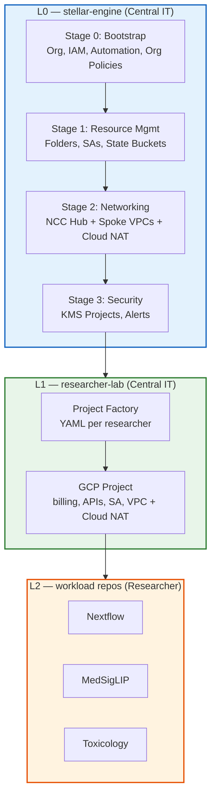
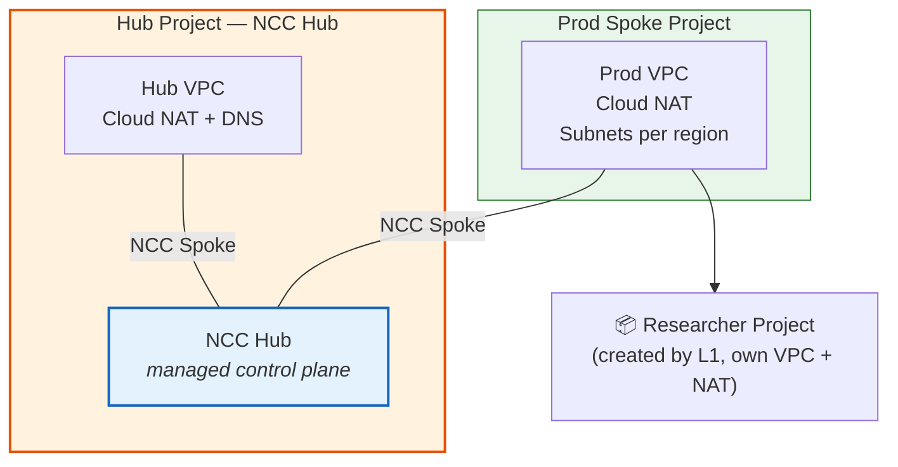
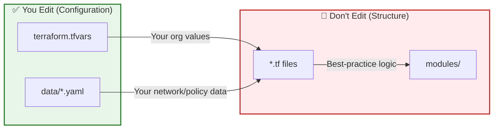

# Fast Science — GCP Landing Zone Foundation (L0)

An implementation of [Stellar Engine](https://github.com/gcp-stellar-engine/stellar-engine) for research institutions. This repo deploys a production-ready GCP Organization landing zone using Terraform — the folders, projects, IAM, networking, and security controls that must exist before researchers can run workloads. Built on Stellar Engine's IaC with compliance overlays (FedRAMP High, IL4, IL5) available when needed.

---

## Architecture Overview

Stellar Engine is **Layer 0** (L0) of a three-tier "Fast Science" architecture:



| Layer | Repo | Owner | Purpose |
|-------|------|-------|---------|
| **L0** | [`fast-science-0-stellar-engine`](https://github.com/WandLZhang/fast-science-0-stellar-engine) (this repo) | Central IT | GCP org landing zone — folders, projects, networking, security |
| **L1** | [`fast-science-1-researcher-lab`](https://github.com/WandLZhang/fast-science-1-researcher-lab) | Central IT | Provision researcher projects via project factory YAML |
| **L2** | Workload repos | Researchers | Science workloads — Nextflow, MedSigLIP, Toxicology, etc. |


---

## Deployment Questionnaire

Fill in your values before starting. Every answer maps directly to a `terraform.tfvars` field.

| # | Question | Your Value | Stage | `terraform.tfvars` Field |
|---|----------|-----------|-------|--------------------------|
| 1 | **Prefix** (≤7 chars, alphanumeric only, e.g. `univ`) | `________` | 0 | `prefix` |
| 2 | **Organization ID** — run `gcloud organizations list` | `________` | 0 | `organization.id` |
| 3 | **Domain** (e.g. `university.edu`) | `________` | 0 | `organization.domain` |
| 4 | **Customer ID** — from `gcloud organizations list` | `________` | 0 | `organization.customer_id` |
| 5 | **Billing Account ID** — run `gcloud beta billing accounts list` | `________` | 0 | `billing_account.id` |
| 6 | **Primary Region** (e.g. `us-east4`) | `________` | 0 | `regions.primary` |
| 7 | **Secondary Region** (optional, e.g. `us-west1`) | `________` | 0 | `regions.secondary` |
| 8 | **Alert Email** (who gets ops alerts) | `________` | 0 | `alert_email` |
| 9 | **Compliance Regime** — `FEDRAMP_HIGH`, `IL5`, `IL4`, or `COMPLIANCE_REGIME_UNSPECIFIED` | `________` | 0 | `assured_workloads.regime` |
| 10 | **Bootstrap Project ID** (you'll create this in Prerequisites) | `________` | 0 | `bootstrap_project` |
| 11 | **Group: Billing Admins** (e.g. `gcp-billing-admins`) | `________` | 0 | `groups.gcp-billing-admins` |
| 12 | **Group: DevOps** (e.g. `gcp-devops`) | `________` | 0 | `groups.gcp-devops` |
| 13 | **Group: Network Admins** (e.g. `gcp-vpc-network-admins`) | `________` | 0 | `groups.gcp-vpc-network-admins` |
| 14 | **Group: Org Admins** (e.g. `gcp-organization-admins`) | `________` | 0 | `groups.gcp-organization-admins` |
| 15 | **Group: Security Admins** (e.g. `gcp-security-admins`) | `________` | 0 | `groups.gcp-security-admins` |
| 16 | *(deprecated)* — environment folders removed; each department has its own Dev/Prod subfolders (L1). | — | — | — |
| 17 | **Networking topology** — `NCC` (recommended) or `NVA` (only if you require L7 inspection / IPS for N-S or E-W traffic) | `NCC` | 2 | Stage 2 dataset choice |
| 18 | **On-prem connectivity?** (N, or VPN/Interconnect) | `N` | 2 | VPN/VLAN config in dataset |
| 19 | **Managed folder name** (optional override; default `it-services` for unspecified regime, regime short code for compliance) | `________` | 0 | `managed_folder_name` |
| 20 | **Department tag key name** (optional override; default `department` — used by L1 to scope per-department org-policy delegation via IAM conditions) | `________` | 0 | `department_tag_key_name` |

---

## Deployment Map

This diagram tracks your deployment progress. All nodes start as **⏳ Planned** (dashed gray). After each stage, update them to **✅ Deployed** (solid colored).

**Unspecified regime** (default L0 deployment) — bootstrap projects + Networking + Security nest inside an `it-services` wrapper folder. Department folders (added by L1) sit as **siblings to `it-services` at the org root**. Compliance regimes (IL5, FedRAMP High, etc.) appear later as separate top-level Assured Workloads folders, each containing their own bootstrap stack + department folders inside.

```mermaid
graph TB
    ORG["🏢 GCP Organization<br/><i>your-domain.edu</i>"]
    TAG["🏷️ Tag key: department<br/><i>⏳ Stage 0 — org-level tag</i>"]

    ORG --> TAG
    ORG --> IT["📁 it-services<br/><i>⏳ Stage 0 — managed folder (configurable name)</i>"]

    IT --> P1["📦 PREFIX-prod-iac-core-0<br/><i>⏳ Stage 0 — Automation + State</i>"]
    IT --> P2["📦 PREFIX-prod-audit-logs-0<br/><i>⏳ Stage 0 — Audit Logging</i>"]
    IT --> P3["📦 PREFIX-prod-billing-exp-0<br/><i>⏳ Stage 0 — Billing Export</i>"]
    IT --> NET["📁 Networking<br/><i>⏳ Stage 1</i>"]
    IT --> SEC["📁 Security<br/><i>⏳ Stage 1</i>"]

    NET --> P4["📦 PREFIX-net-core-0<br/><i>⏳ Stage 2 — Hub VPC + NCC Hub + Cloud NAT</i>"]
    NET --> P5["📦 PREFIX-net-prod-0<br/><i>⏳ Stage 2 — Prod Spoke VPC + Cloud NAT</i>"]

    SEC --> P8["📦 PREFIX-dev-sec-core-0<br/><i>⏳ Stage 3 — Dev KMS</i>"]
    SEC --> P9["📦 PREFIX-prod-sec-core-0<br/><i>⏳ Stage 3 — Prod KMS</i>"]

    ORG --> DEPT["📁 engineering / medicine / ...<br/><i>⏳ L1 — department folders (siblings to it-services)</i>"]
    DEPT --> DEV["📁 Development<br/><i>⏳ L1 — sandbox preset</i>"]
    DEPT --> PROD["📁 Production<br/><i>⏳ L1 — hardened preset</i>"]
    DEV --> RP["📦 researcher projects<br/><i>⏳ created by IT (via L1 PF) or by PIs (via Console)</i>"]

    ORG --> CR["📁 (later) il5 / frh / il4<br/><i>compliance regimes — separate L0 deployments</i>"]

    style ORG fill:#fff,stroke:#333,stroke-width:2px
    style TAG stroke-dasharray: 5 5,stroke:#90a4ae,fill:#fafafa
    style IT stroke-dasharray: 5 5,stroke:#90a4ae,fill:#fafafa
    style NET stroke-dasharray: 5 5,stroke:#90a4ae,fill:#fafafa
    style SEC stroke-dasharray: 5 5,stroke:#90a4ae,fill:#fafafa
    style P1 stroke-dasharray: 5 5,stroke:#90a4ae,fill:#fafafa
    style P2 stroke-dasharray: 5 5,stroke:#90a4ae,fill:#fafafa
    style P3 stroke-dasharray: 5 5,stroke:#90a4ae,fill:#fafafa
    style P4 stroke-dasharray: 5 5,stroke:#90a4ae,fill:#fafafa
    style P5 stroke-dasharray: 5 5,stroke:#90a4ae,fill:#fafafa
    style P8 stroke-dasharray: 5 5,stroke:#90a4ae,fill:#fafafa
    style P9 stroke-dasharray: 5 5,stroke:#90a4ae,fill:#fafafa
    style DEPT stroke-dasharray: 5 5,stroke:#90a4ae,fill:#fafafa
    style DEV stroke-dasharray: 5 5,stroke:#90a4ae,fill:#fafafa
    style PROD stroke-dasharray: 5 5,stroke:#90a4ae,fill:#fafafa
    style RP stroke-dasharray: 5 5,stroke:#90a4ae,fill:#fafafa
    style CR stroke-dasharray: 5 5,stroke:#bdbdbd,fill:#f5f5f5
```




---

## Prerequisites

This guide assumes you have already completed the [GCP Enterprise Setup Checklist](https://cloud.google.com/docs/enterprise/setup-checklist) — specifically, you have a verified domain, a Google Cloud Organization, and either Google Workspace or Cloud Identity configured.

### 1. Install Tools

Install the following on your workstation:

- **[Google Cloud SDK](https://cloud.google.com/sdk/docs/install)** (`gcloud` CLI)
- **[Terraform](https://developer.hashicorp.com/terraform/install)** ≥ 1.7
- **[jq](https://jqlang.github.io/jq/download/)** (used by helper scripts)

Authenticate and set your account:

```bash
gcloud auth login
gcloud auth application-default login
```

### 2. GCP Organization

You need a GCP Organization with a verified domain. Run in your terminal:

```bash
gcloud organizations list
```

Example output:
```
DISPLAY_NAME       ID            DIRECTORY_CUSTOMER_ID
university.edu     1234567890    C000001
```

- **Organization ID** → the `ID` column
- **Customer ID** → the `DIRECTORY_CUSTOMER_ID` column (used for Domain Restricted Sharing org policy — optional)

### 3. Billing Account

Run in your terminal:

```bash
gcloud beta billing accounts list
```

Note the `ACCOUNT_ID` value (format: `012345-67890A-BCDEF0`).

### 4. Choose Your Prefix

Pick a prefix of **≤7 characters** using **only alphanumeric characters** (no hyphens or underscores). E.g.: `univ`. The prefix flows through every resource name automatically — see [naming convention](documentation/naming-convention.md).

### 5. Bootstrap Project

Create a "seed" project. This is the first GCP project in your org — Stellar Engine uses it to bootstrap automation:

```bash
export PREFIX="univ"                        # Your chosen prefix
export ORG_ID="1234567890"                  # Your org ID
export BILLING_ID="012345-67890A-BCDEF0"    # Your billing account ID

# Create the bootstrap project
gcloud projects create ${PREFIX}-bootstrap --organization=${ORG_ID}
gcloud billing projects link ${PREFIX}-bootstrap --billing-account=${BILLING_ID}
gcloud config set project ${PREFIX}-bootstrap

# Set the quota project for Application Default Credentials
# (required for org policy APIs when running Terraform locally)
gcloud auth application-default set-quota-project ${PREFIX}-bootstrap
```

### 6. Enable Required APIs

Run from the repo root:

```bash
cd fast/stages-aw/0-bootstrap
chmod +x enableServices.sh
./enableServices.sh
```

This enables: IAM, Cloud KMS, Pub/Sub, Service Usage, Resource Manager, BigQuery, Assured Workloads, Cloud Billing, Logging, IAM Credentials, Org Policy.

### 7. Google Groups

Stellar Engine uses groups (from the [GCP Enterprise Setup Checklist](https://cloud.google.com/docs/enterprise/setup-checklist)) for all org-level IAM bindings. Create these 5 groups using whichever method matches your identity setup:

| Group | Purpose |
|-------|---------|
| `gcp-billing-admins@yourdomain` | Billing administration |
| `gcp-devops@yourdomain` | DevOps / automation |
| `gcp-vpc-network-admins@yourdomain` | Network administration |
| `gcp-organization-admins@yourdomain` | Organization administration |
| `gcp-security-admins@yourdomain` | Security administration |

<details>
<summary><b>Option A: Google Workspace Admin Console</b></summary>

If your org uses Google Workspace, create groups in [Admin Console → Groups](https://admin.google.com/ac/groups).

</details>

<details>
<summary><b>Option B: gcloud CLI (Cloud Identity / Workforce Identity Federation)</b></summary>

If your org uses Cloud Identity or Workforce Identity Federation, create groups programmatically. This requires the Cloud Identity API enabled on your bootstrap project (created in step 5):

```bash
# Enable Cloud Identity API on your bootstrap project
gcloud services enable cloudidentity.googleapis.com

export DOMAIN="yourdomain.com"
export ORG_ID="1234567890"

for GROUP in gcp-billing-admins gcp-devops gcp-vpc-network-admins gcp-organization-admins gcp-security-admins; do
  gcloud identity groups create "${GROUP}@${DOMAIN}" \
    --organization="${ORG_ID}" \
    --display-name="${GROUP}" \
    --description="Stellar Engine ${GROUP} group"
done
```

These Cloud Identity groups work with Workforce Identity Federation — your external IdP maps federated identities into these GCP groups, which then receive IAM bindings from Stellar Engine.

</details>

### 8. Grant Bootstrap IAM Roles

```bash
cd fast/stages-aw/0-bootstrap
chmod +x setIAM.sh
./setIAM.sh your-email@yourdomain.com ${ORG_ID}
```

This grants the 13 org-level roles needed to run Stage 0 (logging admin, org admin, project creator, billing admin, etc.).

---

## Stage 0: Bootstrap

**Directory:** `fast/stages-aw/0-bootstrap/`  
**What it creates:** A managed wrapper folder (default name `it-services` for unspecified regime; an Assured Workloads folder named after the regime short code like `il5` / `frh` for compliance) that contains the automation project (Terraform state buckets + SAs), audit logs project, billing export project. Also creates org policies, custom roles, KMS keys, and an **org-level tag key `department`** used by L1 to scope folder-level org-policy admin delegation via IAM conditions. Override the wrapper folder name with `var.managed_folder_name`; override the tag key name with `var.department_tag_key_name`.

### Step 1 — Configure variables

```bash
cd fast/stages-aw/0-bootstrap
cp terraform.tfvars.sample terraform.tfvars
```

Edit `terraform.tfvars` — lines marked `# ← CHANGE` are the values you must set to match your environment. Everything else can stay as-is:

```hcl
# ─── MUST CHANGE: Your org-specific values ─────────────────────
prefix            = "univ"                        # ← CHANGE: ≤7 chars
bootstrap_project = "univ-bootstrap"              # ← CHANGE: the project you created in step 5
alert_email       = "cloud-ops@university.edu"    # ← CHANGE: who receives alerts

organization = {
  domain      = "university.edu"                  # ← CHANGE: from gcloud organizations list
  id          = 1234567890                        # ← CHANGE: from gcloud organizations list
  customer_id = "C000001"                         # ← CHANGE: from gcloud organizations list (optional)
}

billing_account = {
  id = "012345-67890A-BCDEF0"                     # ← CHANGE: from gcloud beta billing accounts list
}

regions = {
  primary   = "us-east4"                          # ← CHANGE: your preferred region
  secondary = "us-west1"                          # ← OPTIONAL: secondary region for multi-region NVA
}

# ─── OPTIONAL: Change only if needed ───────────────────────────
# Set regime to "COMPLIANCE_REGIME_UNSPECIFIED" to skip Assured Workloads
# Set to "FEDRAMP_HIGH", "IL5", "IL4", etc. to enable compliance overlay
assured_workloads = {
  regime   = "COMPLIANCE_REGIME_UNSPECIFIED"
  location = "us-east4"
}

# If you used the default group names in step 7, leave these as-is
groups = {
  gcp-billing-admins      = "gcp-billing-admins"
  gcp-devops              = "gcp-devops"
  gcp-vpc-network-admins  = "gcp-vpc-network-admins"
  gcp-organization-admins = "gcp-organization-admins"
  gcp-security-admins     = "gcp-security-admins"
}

# ─── DEFAULTS: Leave as-is unless you know what you're doing ──
org_policies_config = {
  import_defaults = false
  constraints = {
    allowed_policy_member_domains = []
  }
}

fast_features = {
  # teams and project_factory default to true (the Fast Science L1 model
  # needs both). Set to false only to opt out.
  # teams           = true   # default — creates department folders + tag delegation
  # project_factory = true   # default — IT can create projects in dept folders
}

log_sinks = {
  audit-logs = {
    filter = "logName:\"/logs/cloudaudit.googleapis.com%2Factivity\" OR logName:\"/logs/cloudaudit.googleapis.com%2Fsystem_event\" OR protoPayload.metadata.@type=\"type.googleapis.com/google.cloud.audit.TransparencyLog\""
    type   = "pubsub"
  }
  vpc-sc = {
    filter = "protoPayload.metadata.@type=\"type.googleapis.com/google.cloud.audit.VpcServiceControlAuditMetadata\""
    type   = "pubsub"
  }
  workspace-audit-logs = {
    filter = "logName:\"/logs/cloudaudit.googleapis.com%2Fdata_access\" and protoPayload.serviceName:\"login.googleapis.com\""
    type   = "pubsub"
  }
  empty-audit-logs = {
    filter = ""
    type   = "pubsub"
  }
}

outputs_location = "~/fast-config"
```

### Step 2 — First apply (with bootstrap user)

On the very first run, temporarily add `bootstrap_user` to relax org policies:

```bash
# Add this line to terraform.tfvars temporarily:
# bootstrap_user = "your-email@university.edu"

terraform init
terraform plan
terraform apply
```

### Step 3 — Second apply (enforce org policies)

Remove `bootstrap_user` from `terraform.tfvars`, then re-apply:

```bash
# Remove the bootstrap_user line from terraform.tfvars
terraform plan
terraform apply
```

### Step 4 — Verify outputs

```bash
terraform output project_ids
terraform output service_accounts
terraform output assured_workload
```

Stage 0 outputs are automatically written to `~/fast-config/` (or GCS bucket) for Stage 1 to consume.

> **📋 Update Deployment Map:** Stage 0 is complete. In the Deployment Map diagram above, change nodes **TAG**, **IT**, **P1**, **P2**, **P3** from `⏳ Planned` to `✅ Deployed`. Replace `PREFIX` with your actual prefix from the questionnaire. Change their styles from dashed gray to solid: TAG → `fill:#fff3e0,stroke:#e65100`, IT → `fill:#e3f2fd,stroke:#1565c0,stroke-width:2px`, P1/P2/P3 → `fill:#e8f5e9,stroke:#2e7d32`.

---

## Stage 1: Resource Management

**Directory:** `fast/stages-aw/1-resman/`  
**What it creates:** The organizational folder structure for downstream stages — Networking and Security folders nested under the managed wrapper. This stage no longer creates env folders (Prod/Int/Test) — each department gets its own Development/Production subfolders via L1, so a separate top-level env wrapper is redundant.

For department folder creation + IAM delegation + folder-level org policies + per-dept tag bindings, proceed to the **[L1 researcher-lab repo](https://github.com/WandLZhang/fast-science-1-researcher-lab)** after Stage 3.

### Step 1 — Link outputs from Stage 0

```bash
cd fast/stages-aw/1-resman
../../stage-links.sh ~/fast-config
# Copy and paste the output commands
```

### Step 2 — Apply

No tfvars needed for L0's Stage 1 — defaults are correct (`fast_features.teams = true`, `fast_features.project_factory = true` enable L1's per-department resources when you deploy the L1 repo).

```bash
terraform init
terraform plan
terraform apply
```

> **📋 Update Deployment Map:** Stage 1 is complete. In the Deployment Map diagram above, no nodes change at this stage (the `NET` and `SEC` folder modules are created by 1-resman but rendered as already-deployed once Stage 2/3 fills them).

---

## Stage 2: Networking

**Choose your topology** (from questionnaire Q17):

### Option A: NCC Hub-and-Spoke (Default — Recommended)

**Best for:** Most research universities, non-compliance workloads, rapid researcher onboarding.

[Network Connectivity Center (NCC)](https://cloud.google.com/network-connectivity/docs/network-connectivity-center) provides a managed hub-and-spoke topology where each spoke VPC has its own Cloud NAT for internet egress. No NVAs, no complex cross-project agent IAM — researchers can `pip install`, download datasets, and pull models without any special networking config.



**What it creates:** Hub project with NCC hub + Cloud NAT, per-environment spoke projects with their own VPCs and Cloud NAT, NCC full-mesh connectivity, DNS zones, hierarchical firewall policies.

**Internet egress:** Each spoke VPC has its own Cloud NAT → `pip install`, HuggingFace, Zenodo, nf-core all work directly. No central bottleneck.

**How it works:**
- NCC hub acts as a managed control plane for route exchange between spokes
- L1 researcher projects connect to the spoke VPC for networking (Cloud NAT handles internet)
- Cloud NAT per spoke provides independent internet egress
- DNS centralized in hub with peering zones in spokes
- Transitive routing between spokes via NCC (if needed)

### Option B: NVA with Traffic Inspection

**Best for:** Deployments that require Layer 7 inspection / IPS for North-South or East-West traffic — regardless of compliance regime. If your ATO or security team does not mandate inline L7 inspection, use NCC instead.

Uses Network Virtual Appliances (NVAs) to inspect traffic between spokes and before internet egress. The NVA path lives in the **same `fast/stages/2-networking/` stage** as NCC — you select it by pointing `factories_config.dataset` at `datasets/hub-and-spokes-nva`, and you choose the appliance behind the load balancers:

- **Simple Linux NVA** (default for the NVA dataset): COS-based iptables router — forwards and masquerades traffic but provides no L7 inspection. A placeholder/starting point.
- **Palo Alto NGFW (full)**: set `paloalto.enabled = true`. Deploys a production-grade **2-tier Palo Alto VM-Series** design (ported and generalized from a real NJ-OIT deployment):
  - **E/W firewall** (mngt+trust NICs) and **N/S firewall** (mngt+trust+untrust NICs), each a stateful regional MIG with rolling updates.
  - **NCC STAR topology** (trust/mngt as center spokes) with **policy-based routes** forcing east-west traffic through the E/W firewall.
  - **Panorama auto-registration**: firewalls bootstrap from GCS and register with your Panorama by `panorama_server` IP; Panorama pushes the real policy (Day 2).
  - **Session-affinity ILBs** (`CLIENT_IP_NO_DESTINATION`) for stateful-firewall flow symmetry, Cloud NAT on untrust, HA VPN to on-prem, and private-googleapis DNS on the trust VPC.
  - Enable via `datasets/hub-and-spokes-nva/paloalto.auto.tfvars.sample` (panorama_server is required).

> **Day 2 (Palo Alto):** Terraform stands up the firewalls, networking, and Panorama *registration*. Your security team manages the actual policy (security profiles, threat prevention, URL filtering, decryption, BYOL license auth codes) from Panorama. The firewalls are stateless/cattle — they re-bootstrap and re-register on recreation.
>
> **Prerequisites:** a reachable Panorama, Palo Alto VM-Series BYOL licensing, and the `mngt`/`trust`/`untrust` VPCs (shipped in the `hub-and-spokes-nva` dataset). `terraform validate` confirms the wiring; full `apply` requires the license + Panorama.

The legacy hand-built FedRAMP/IL5 NVA stages remain under `fast/stages-aw/2-networking-{a,b}` for reference, but the maintained NVA path is the dataset above.

### Steps (both topologies)

#### Step 1 — Link outputs from previous stages

```bash
# NCC topology (default):
cd fast/stages/2-networking
# OR NVA topology (IL5):
cd fast/stages-aw/2-networking-a-fedramp-high

../../stage-links.sh ~/fast-config
# Copy and paste the output commands
```

#### Step 2 — Customize network data files

Edit the YAML factory files in `data/`:

| File | What You Set |
|------|-------------|
| `data/vpcs/*/` | VPC configs, subnets, NAT |
| `data/ncc-hubs/` | NCC hub config (NCC only) |
| `data/firewall-policies/` | Hierarchical firewall rules |
| `data/dns/` | DNS zones and response policies |

#### Step 3 — Apply

```bash
terraform init
terraform plan
terraform apply
```

> **📋 Update Deployment Map:** Stage 2 is complete. In the Deployment Map diagram above, change nodes **P4** and **P5** from `⏳ Planned` to `✅ Deployed`. Change their styles from dashed gray to solid: P4/P5 → `fill:#fff3e0,stroke:#e65100`.

---

## Stage 3: Security

**Directory:** `fast/stages-aw/3-security/`  
**What it creates:** Dev and Prod KMS projects, HSM-backed keyrings and keys across US regions, VPC Service Controls perimeter (optional).

### Step 1 — Link outputs and set default project

```bash
cd fast/stages-aw/3-security
../../stage-links.sh ~/fast-config
# Copy and paste the output commands

# Set default project to the automation project
gcloud config set project $(cd ../0-bootstrap && terraform output -raw project_ids | jq -r .automation)
```

### Step 2 — Apply

```bash
terraform init
terraform plan
terraform apply
```

### Step 3 — Lock down service accounts (production hardening)

```bash
chmod +x sa_lockdown.sh
./sa_lockdown.sh
```

### Step 4 — Optionally delete the bootstrap project

```bash
chmod +x delete_gcp_project.sh
./delete_gcp_project.sh --project-id=${PREFIX}-bootstrap
```

> **📋 Update Deployment Map:** Stage 3 is complete. In the Deployment Map diagram above, change nodes **SEC**, **P8**, **P9** from `⏳ Planned` to `✅ Deployed`. Change their styles from dashed gray to solid: SEC/P8/P9 → `fill:#fce4ec,stroke:#c62828`. All L0 infrastructure is now deployed! Proceed to the [L1 Researcher Labs](https://github.com/WandLZhang/fast-science-1-researcher-lab) repo for researcher project provisioning.

---

## What You Touch vs What You Don't



| Stage | ✅ Edit | 🚫 Don't Edit |
|-------|---------|---------------|
| **0-bootstrap** | `terraform.tfvars` — prefix, org, billing, groups, regime, features | `*.tf` — automation, org, IAM, logging logic |
| **0-bootstrap** | `data/org-policies/*.yaml` — org policy rules | `variables.tf` — type definitions |
| **0-bootstrap** | `data/custom-roles/*.yaml` — custom IAM roles | |
| **1-resman** | `terraform.tfvars` — tenants, envs_folders, features | `branch-*.tf` — folder/SA creation logic |
| **2-networking** | `data/cidrs.yaml`, `data/subnets/*.yaml`, `data/firewall-rules/*.yaml` | `main.tf` — network topology |
| **3-security** | `terraform.tfvars` — kms_keys, vpc_sc | `core-dev.tf`, `core-prod.tf` — KMS project logic |
| **3-security** | `data/vpc-sc/*.yaml` — VPC-SC perimeter definitions | |

> **Why?** Keeping `.tf` files untouched means your fork stays merge-able with upstream [Cloud Foundation Fabric](https://github.com/GoogleCloudPlatform/cloud-foundation-fabric). Your customizations live entirely in config/data files that upstream doesn't ship with real values.

> **Exceptions:** This fork modifies a small number of `.tf` files to fix upstream limitations around multi-region NVA support. Each change is marked with an inline comment starting with `# Upstream:` explaining what the original code did and why it was changed. These are minimal, targeted changes that extend `for_each` loops and variable types — they don't rewrite any logic.

### How Naming Works

Your prefix automatically propagates to every resource:

```
terraform.tfvars: prefix = "univ"
    ↓
main.tf: local.prefix = join("-", ["univ", "prod"])  →  "univ-prod"
    ↓
automation.tf: module { name = "iac-core-0", prefix = "univ-prod" }
    ↓
GCP: project "univ-prod-iac-core-0" ✅
```

See [naming convention documentation](documentation/naming-convention.md) for the full spec: `{base}-{regime}-{env}-{role}-{0-9}`.

---

## Next Steps: L1 and L2

Once all 4 stages complete successfully, your landing zone is ready.

```
✅ L0 Complete — Your GCP organization has:
   • Folder hierarchy with compliance boundary
   • Automation project with Terraform service accounts
   • Hub-and-spoke networking (NCC default, NVA for IL5) with Cloud NAT
   • KMS encryption keys (HSM-backed)
   • Org policies and audit logging
   • Project factory SAs and state buckets (if enabled)

→ Next: Create researcher projects via L1 project factory
→ Then: Researchers deploy L2 workloads in their projects
```

Proceed to the [L1 Researcher Labs](https://github.com/WandLZhang/fast-science-1-researcher-lab) repo to create researcher projects using Stellar Engine's project factory module. Each researcher gets a YAML file → a GCP project with 24 APIs, SA, billing, logging, and monitoring pre-configured.

---

## Modules

The suite of [modules](./modules/) is designed for rapid composition and reuse. All modules share a similar interface: IAM support, resource creation/modification, multiple resource creation where sensible, and no side-effects. Modules ending with `-se` are Stellar Engine-specific modifications. See each module's README for usage.

## Blueprints

Compliance-mapped blueprints for [FedRAMP High](./blueprints/fedramp-high/) and [IL5](./blueprints/il5/) — from full end-to-end services (CNAP) to individual GCP services. See each blueprint's README.

---

<details>
<summary><b>📚 Reference Documentation</b></summary>

### Detailed Deployment Guide (DDG)

Step-by-step deployment manual covering all stages, IAM prerequisites, and troubleshooting. [View DDG](https://docs.google.com/document/d/1UOaHefcxHCl2C4CbYsTl37ZRxB4xmDHbWmfLcF0VY70/edit?pli=1&tab=t.0#heading=h.7axmtvj2exmb) (requires access).

### Technical Design Document (TDD)

Architecture framework covering IAM, org hierarchy, hub-and-spoke networking, encryption, and compliance. [View TDD](https://docs.google.com/document/d/15WMwslyCrkmuI7EutGBd7YXH3K8P3KrwzLOGcv-W4t8/edit?resourcekey=0-mjoA_PGM2MkIMPpr75SQbQ&tab=t.0) (requires access).

### Security Best Practices Guide (SBPG)

Security hardening framework with Mandiant pen-test recommendations. [View SBPG](https://docs.google.com/document/d/1uv62Fqg73r9oJNP-NPZebpzoBom8rOgLoHkiMZPutbo/edit?usp=sharing) (requires access).

### Cybersecurity Documentation

NIST 800-53r5 control mappings for FRH, IL4, IL5. [View docs](https://drive.google.com/drive/folders/1NeWZcOuxysi7kUNRCFDd8CeHnxF14ywp) • [Path to Authorization guide](https://docs.google.com/document/d/1vyrWgLIXWkZO3c5qkqLhltmo4LMrVfDHx0EQCuQMYac/edit?tab=t.0#heading=h.qyoze3epkux8) (requires access).

### Assured Workloads

Google Cloud Assured Workloads simplifies creating compliant environments (FedRAMP, HIPAA, CJIS, etc.). [Pricing and docs](https://cloud.google.com/security/products/assured-workloads?hl=en).

</details>

<details>
<summary><b>🤝 Contributing</b></summary>

- **View access:** Fill out this [form](https://docs.google.com/forms/d/e/1FAIpQLScetWXBErWaopYrGa8qKz6vFZOz1-_O0o_HAU4tr4vdhMzWpQ/viewform) for [GitHub](https://github.com/gcp-stellar-engine/stellar-engine) access
- **Issues:** Create an issue on GitHub and email [stellar-engine@google.com](mailto:stellar-engine@google.com)
- **Code contributions:** Email [stellar-engine@google.com](mailto:stellar-engine@google.com) for developer access

</details>

<details>
<summary><b>⚖️ License & Disclaimers</b></summary>

This is not an officially supported Google product. This project is not eligible for the [Google Open Source Software Vulnerability Rewards Program](https://bughunters.google.com/open-source-security).

</details>
